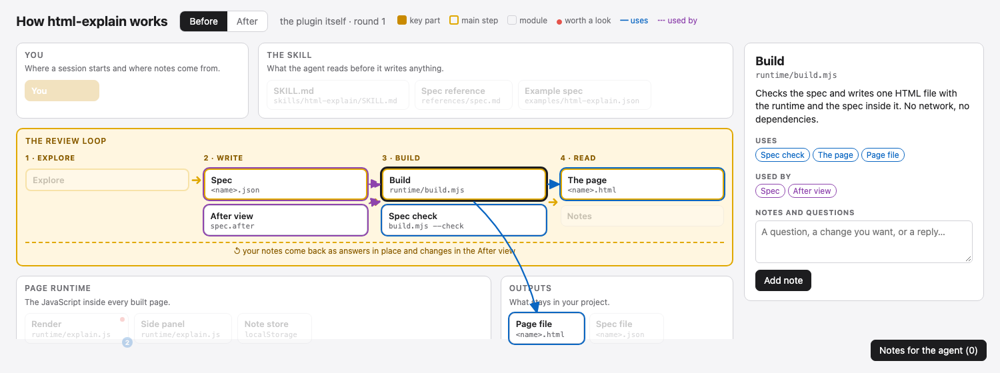

# html-explain

`/html-explain` draws a system as one interactive HTML page: boxes grouped by role, arrows
between them, and a short plain description behind every box. You click any box or arrow and
leave notes (questions or changes you want); each reaches your agent as you post it. It answers
each note in place on the page and draws an **After** view of the system with the changes you
agreed on.
Rounds repeat until you are happy; then the agent can build the After view.

Use it to understand a codebase or one part of it, or to redesign it with your agent.



## Install

In Claude Code:

```console
/plugin install html-explain --marketplace Akramz/html-explain
```

The page is built by a small Node script, so you need [Node.js](https://nodejs.org) 18 or later.

## Use

```console
/html-explain                          # the whole repository
/html-explain the job runner           # one part of it
/html-explain how a request reaches the database
```

1. The agent reads the code and opens the page. Click a box: the panel says what it does, what
   it uses and what uses it, and its arrows appear. Red dots mark things that may not fit a
   simple design.
2. Leave notes on any box, arrow or the page. The page is served live from your machine: each
   note reaches the agent as soon as you add it, and it starts working on it.
3. The agent answers the note in its thread, agrees or pushes back with a reason, and updates
   the **After** view. **↻ Load the agent's changes** appears; click it to see them in place,
   without losing what you are typing. Flip Before / After to compare. Keep talking in the
   threads.
4. When the After view is what you want, ask the agent to build it.

The spec (`<name>.json`) is the source and the page (`<name>.html`) is one self-contained file
you can open, share or commit. Opened as a file, the page works offline: notes stay in your
browser until **Notes for the agent** copies them for you to paste into the chat.

The live server listens on `127.0.0.1` only and answers only the page it served: that page
carries a random token, and calls without it, from another site or for another host are refused. See [the spec reference](plugin/skills/html-explain/references/spec.md)
and [the example](plugin/skills/html-explain/examples/html-explain.json), built as
[docs/example.html](docs/example.html).

## Develop

```console
make check     # runtime syntax, the example spec, and the build tests
make example   # rebuild docs/example.html
```

## License

MIT
